
<a href="README.md">English</a> · <a href="README.zh-CN.md">简体中文</a>

  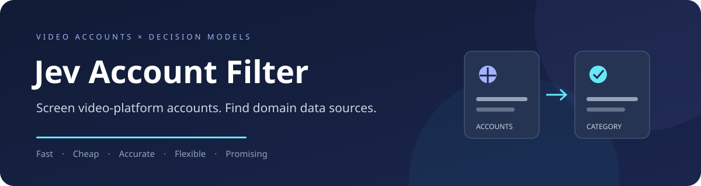
  
<strong>Find the accounts. Build the dataset.</strong>

  
Account screening and channel classification with decision models: find sign language creators and other domain-specific sources for datasets and research.

  
<kbd>Fast</kbd>　<kbd>Cheap</kbd>　<kbd>Accurate</kbd>　<kbd>Flexible</kbd>　<kbd>Promising</kbd>

  
<a href="docs/installation.md">Installation</a> · <a href="docs/commands.md">Commands</a> · <a href="docs/configuration.md">Configuration</a>

---

## Introduction

Collecting datasets from user-generated content communities is becoming an increasingly common approach to training models. Video platforms host a continuous stream of real-world content from diverse creators, offering opportunities to scale training data, broaden its distribution, and represent more people. Finding sources relevant to a specific domain within this growing collection has become an important part of dataset construction.

A common collection pipeline first identifies relevant accounts, then uses video models and human review to select individual videos suitable for training. Previous work has explored manually curated sources, automatic candidate retrieval, and channel-level sampling, yet source selection and content review still require human effort.   As the number of candidate accounts grows, the cost of browsing and judging them increases. Changes to category boundaries or collection goals can also require repeating part of that work. **Account screening has therefore become a bottleneck in domain dataset collection.**

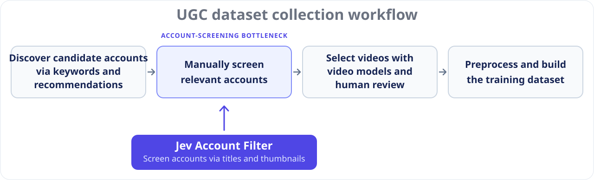

An account's profile page already provides useful previews: titles describe video topics, thumbnails supply visual cues, and the account name and biography describe the creator's focus. These signals offer a basis for inexpensive source selection. Meanwhile, decision models can turn supplied evidence directly into category choices and relevance probabilities, answering several independent questions in a single request. This makes them suitable for large-scale, repeatable screening.

**To the best of our knowledge, Jev Account Filter is the first project to screen video-platform accounts without downloading or watching full videos.** It first selects candidates by title, then combines their thumbnails with account metadata to judge the account's category independently, turning a large pool of accounts into a reviewable list of collection sources. Collected evidence and screening rules are stored separately, allowing researchers to revise criteria, replace models, and compare results using the same collected data. Accounts include both creator profiles and channels on video platforms. Sign-language screening is one validated application; other domains can be selected through category configurations.

Our team is already using this project to screen sign-language accounts on short-video platforms. We welcome contributions that extend its applications to other domains and research needs.

### Advantages

We screened **2,140 Douyin accounts** for sign-language content with **Jev 1.14**: **8 hours** of data collection and **1 hour** of API inference, at a total API cost of **$0.565** and **94.49%** accuracy.

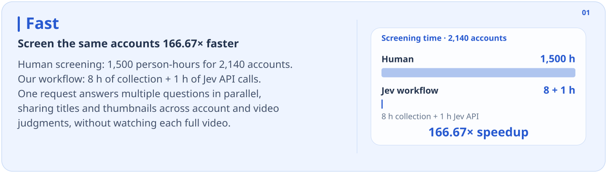

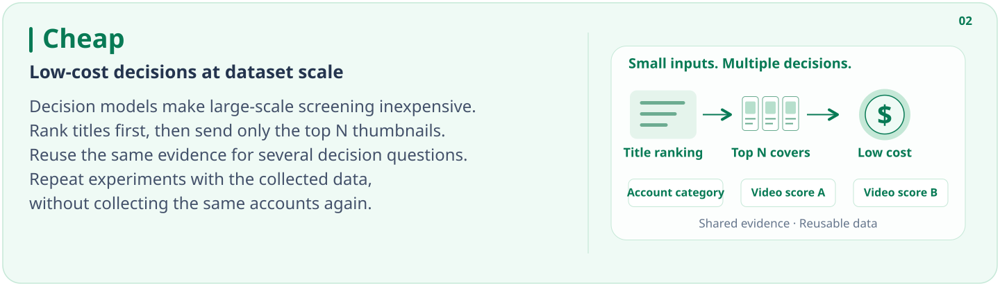

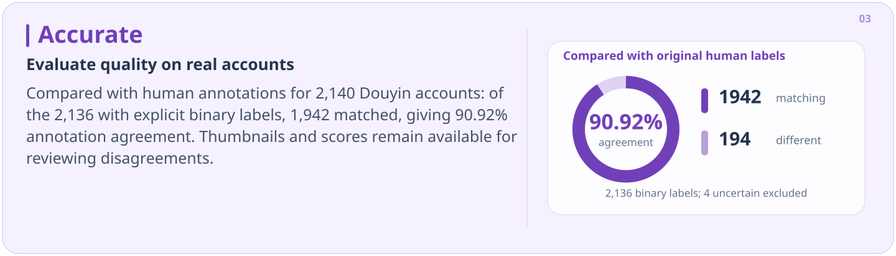

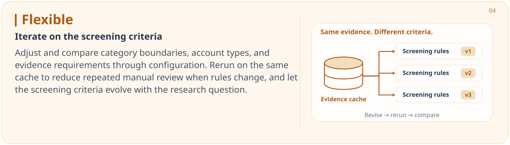

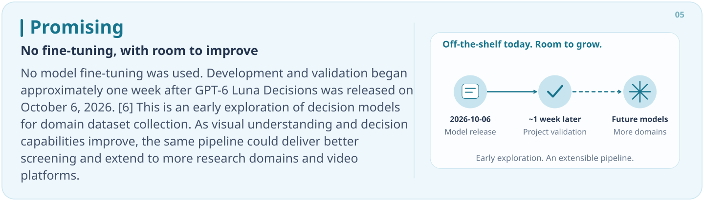

## Application domains

**Jev Account Filter can support both model-training dataset construction and sample selection and analysis for research, including news and communication studies.** The examples below include major datasets and representative studies whose papers and methods document human channel screening or curation of channel sources. The project could replace the manual channel-screening stage in these workflows. Sign language is the validated application; other domains can be explored through new category configurations.

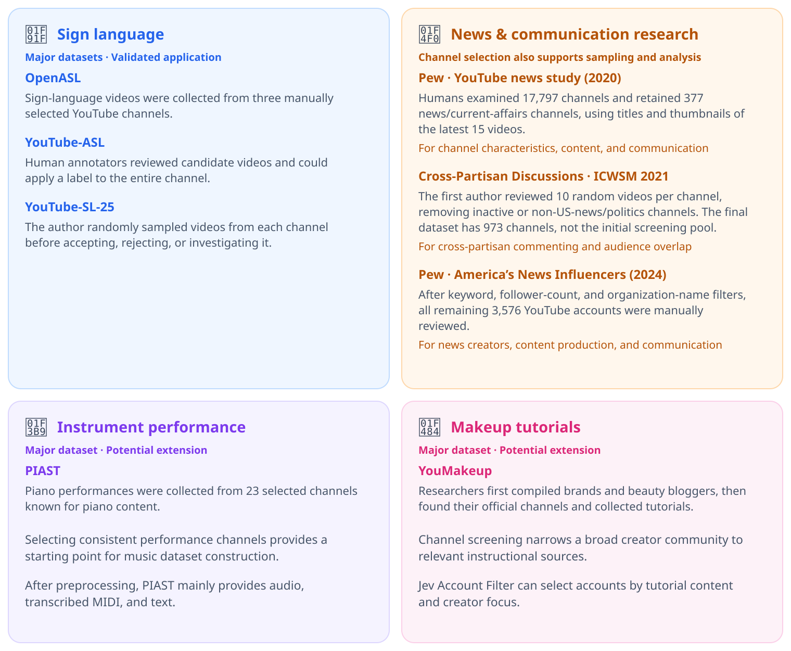

- **Sign language account discovery:** find sign language channels and creators as sources for sign language translation datasets. OpenASL, YouTube-ASL, and YouTube-SL-25 illustrate the need to select relevant channel sources; our account-screening experiment evaluates this domain.
- **News and communication research:** screen news and current-affairs channels to build research samples for studying news creators, audience overlap, and cross-partisan discussions. Pew's YouTube studies illustrate this manual screening workload.
- **Instrument performance datasets:** identify piano and other instrument-performance channels before collecting music videos. PIAST illustrates the role of curated channel sources in music dataset construction.
- **Makeup tutorial datasets:** select beauty creators and makeup tutorial channels before collecting instructional videos. YouMakeup illustrates this source-selection stage.

The latter three are potential applications, requiring their own category rules and evaluation; they are not additional validated benchmarks.

Dataset papers: [OpenASL · §3](https://aclanthology.org/2022.emnlp-main.427.pdf#page=3) · [YouTube-ASL · §2.1, §3.2](https://papers.nips.cc/paper/2023/file/5c61452daca5f0c260e683b317d13a3f-Paper-Datasets_and_Benchmarks.pdf#page=4) · [YouTube-SL-25 · §2.2](https://arxiv.org/html/2407.11144#S2.SS2) · [PIAST · §2.2](https://arxiv.org/html/2411.02551v2#S2.SS2) · [YouMakeup · §3.1](https://aclanthology.org/anthology-files/pdf/D/D19/D19-1517.pdf#page=4).

Study methods: [Pew: YouTube news study (2020)](https://www.pewresearch.org/journalism/2020/09/28/youtube-news-methodology/) · [Cross-Partisan Discussions on YouTube: Conservatives Talk to Liberals but Liberals Don't Talk to Conservatives · §3.2–3.3 (ICWSM 2021)](https://ojs.aaai.org/index.php/ICWSM/article/download/18105/17908/21600#page=4) · [Pew: America’s News Influencers (2024) · YouTube subsection](https://www.pewresearch.org/journalism/2024/11/18/news-influencers-methodology/).

## Supported platforms

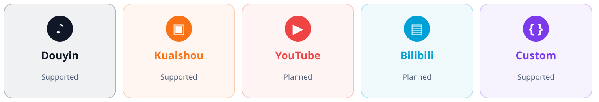

Collection adapters and category rules are independent. Custom sources only need to follow the [data format](docs/data-format.md); a platform adapter is unnecessary.

## Method

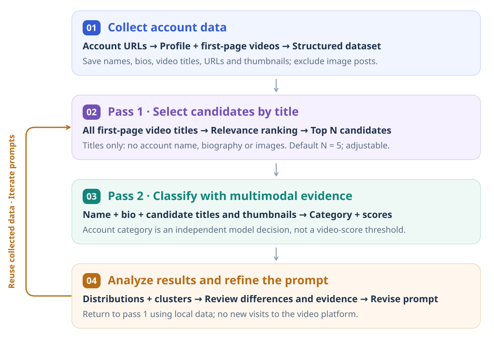

## Visual analysis

Screening produces more than an account list. The interactive analysis page brings together class composition, classification performance, score distributions, and feature clusters. Select a group in a chart to inspect individual accounts, candidate titles, thumbnails, and model scores. Adding a second-review CSV automatically updates the evaluation reference and enables a comparison of human annotation errors and model errors.

The statistical views below come from the latest complete **Jev 1.14 experiment on 2,140 Douyin accounts**; account-level evidence uses the explicitly published demo subset. The team's full account list and collected works remain private.

**Dataset composition and performance.** Class proportions describe the sample, while the reviewed comparison separates model errors from original annotation errors. Accuracy is a conditional estimate: the 198 previously reviewed accounts use second-review labels; the other 1,942 retain their original labels, assumed correct.

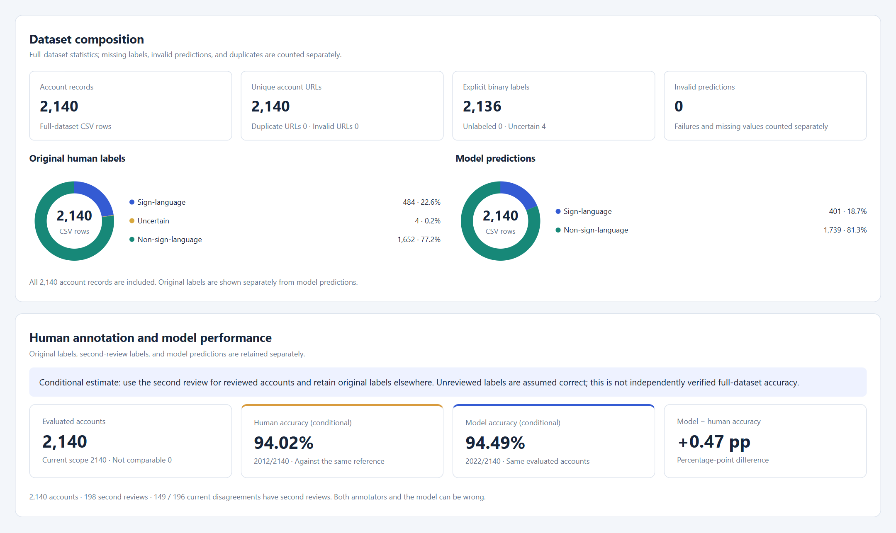

**Errors and score distributions.** The confusion matrix separates missed accounts from false inclusions. Normalized histograms compare account probabilities for human-error and model-error samples, helping identify score ranges that warrant closer review. The two error groups can overlap.

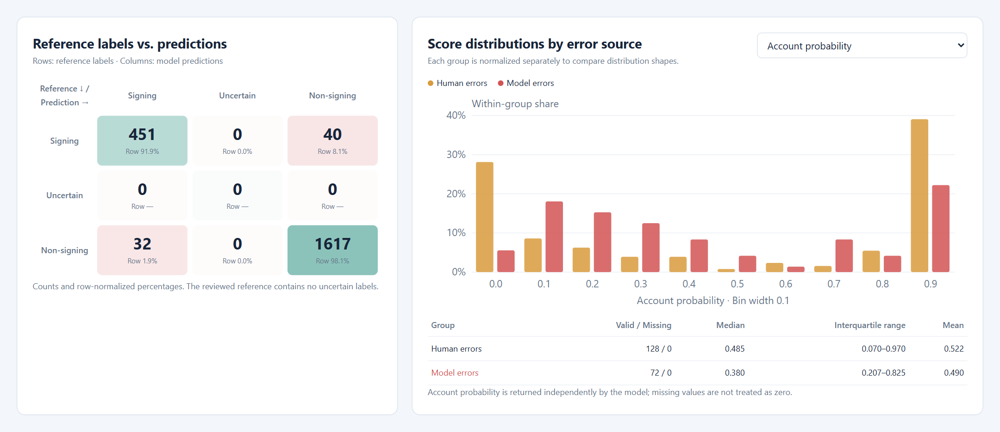

**Clusters of model outputs.** The predicted category and five candidate-video scores describe groups with different evidence profiles. The scatter plot shows a PCA projection; group panels report mean video scores and within-group error rates. Accounts missing any of the five scores are excluded without zero imputation. Clustering describes the results without changing the classification rules.

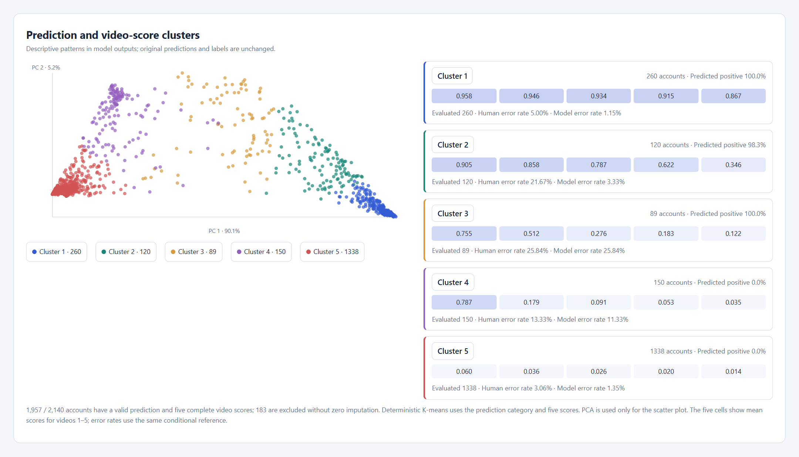

**Human annotation and model error profiles.** Compare within-group error rates by reference category, feature cluster, or highest video score. The two grouping views below show that the model does not outperform humans in every score range; differences in intermediate-score groups can help prioritize further review. The same conditional evaluation reference applies.

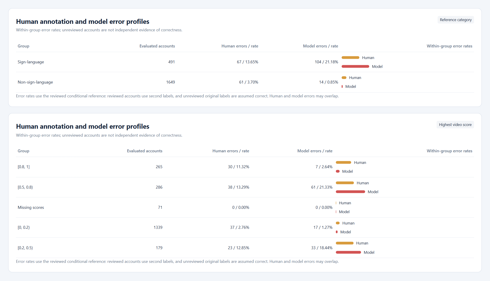

**Account evaluation and supporting evidence.** Original annotations, second reviews, current reference labels, and model predictions are shown side by side to distinguish annotation errors from model errors. This partial view shows three explicitly published accounts and one account's five candidate titles, thumbnails, and scores. The interactive page supports filtering and opening other records.

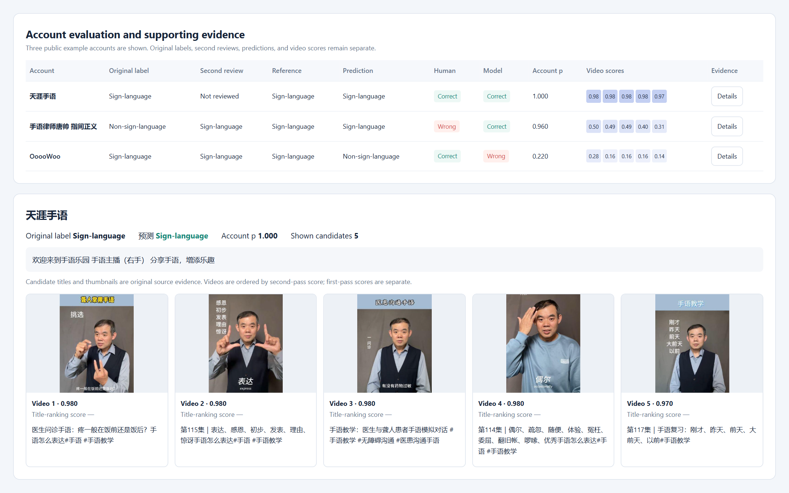

Opening [`analysis.html`](analysis.html) first displays **six real public examples**. Select your own result CSV and optional external data folders to analyze different experiments in the same page, without starting a server or regenerating reports. Statistical figures above use the full experiment; the account screenshot and default interactive demo use the public subset.

## Getting started

**[Installation and environment](docs/installation.md)**: prepare the local Python environment and browser.
**[Configuration](docs/configuration.md)**: choose a provider, model, and target category.

[Commands](docs/commands.md) · [Data format](docs/data-format.md)

## License and citation

The project code and original documentation are available under the [MIT License](LICENSE). Third-party components retain their own licenses, including the [platform icons](docs/assets/platform-icons/LICENSE-simple-icons.txt). Publication of the demonstration subset does not transfer rights to creators' images, titles, or profile content.

If you use this project in research, please cite the repository using [CITATION.cff](CITATION.cff). Contributions that extend account screening to new categories, platforms, or research workflows are welcome.
