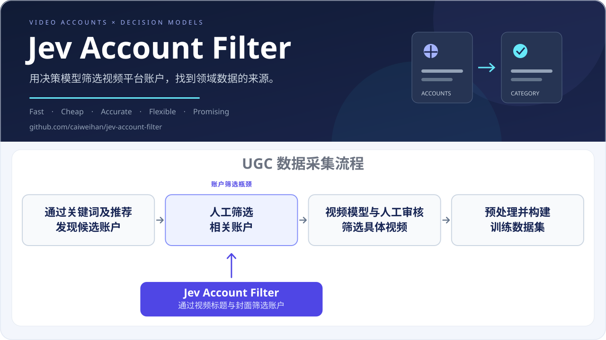

<a href="README.md">English</a> · <a href="README.zh-CN.md">简体中文</a>

  
  
<strong>Find the accounts. Build the dataset.</strong>

  
用决策模型批量筛选视频平台账号、分类频道、寻找手语账号，为领域数据集构建与研究选择创作者。

  
<kbd>Fast</kbd>　<kbd>Cheap</kbd>　<kbd>Accurate</kbd>　<kbd>Flexible</kbd>　<kbd>Promising</kbd>

  
<a href="docs/installation.zh-CN.md">安装</a> · <a href="docs/commands.zh-CN.md">运行指南</a> · <a href="docs/configuration.zh-CN.md">配置说明</a>

---

## 引言

从用户创作社区采集数据集，用于模型训练，正在成为越来越常见的研究路径。视频平台汇集了大量创作者持续发布的真实场景内容，为扩大训练数据规模、丰富内容分布和覆盖更多人群提供了机会。如何从这些持续增长的内容中找到特定领域的数据来源，也随之成为数据集构建的重要问题。

一条常见的采集路线是先确定相关账户，再通过视频模型和人工检查，筛出其中适合训练的具体视频。已有研究尝试了人工整理来源、自动检索候选和按频道抽查等方法，但筛选来源及审核内容仍需要投入人工。   候选账户越多，逐个浏览和判断的成本就越高；当类别边界或采集目标改变时，部分工作还需要重做。**账户筛选因此成为领域数据采集中的一道瓶颈。**

账户主页本身已经提供了丰富的预览信息：标题表达作品主题，封面呈现视觉线索，名称和简介补充创作者定位。这些信息为低成本的来源判断提供了可能。与此同时，决策模型能够把给定证据直接转换为类别选择和相关性概率，并在同一请求中回答多个独立问题，适合大规模、可重复的筛选任务。

**据我们所知，Jev Account Filter 是首个筛选视频平台账户的项目，无需下载或逐个观看完整视频。** 项目先根据标题选择候选，再结合候选封面与账户资料独立判断账户类别，将大量备选账户转化为可采集、可复核的来源清单。采集资料与筛选规则分别保存，研究者可以在同一份采集数据上反复调整判据、替换模型并比较结果。这里的账户包括视频平台的创作者账号与频道；手语筛选是已经验证的一项应用，其他领域可通过类别配置接入。

我们组已经在使用本项目筛选短视频平台的手语账号，欢迎大家拓展项目的应用范围。

### 优点

我们使用 **Jev 1.14** 在 **2140 个抖音账户**上完成手语账户筛选：数据采集 **8 小时**、API 推理 **1 小时**，API 总费用 **$0.565**，预测准确率 **94.49%**。

## 应用领域

**Jev Account Filter 既可用于构建模型训练集，也可为新闻传播等研究提供样本筛选与分析支持。** 下方列举了多个领域的重要数据集和代表性研究，它们的论文和方法记录了人工筛选频道或整理频道来源的过程。本项目未来可替代其中的人工频道筛选环节。手语是已验证的应用，其他领域可通过新的类别配置拓展。

- **寻找手语账号：** 批量筛选手语频道与创作者，为手语翻译数据集选择视频来源。OpenASL、YouTube-ASL、YouTube-SL-25 展示了筛选相关频道的需求；本项目的账号筛选实验已验证这一领域。
- **新闻传播研究：** 筛选新闻频道与时事账号，构建研究样本，用于分析新闻创作者、受众重叠及跨政治立场的讨论。Pew 的 YouTube 研究展示了这类人工筛选的工作量。
- **乐器演奏数据集：** 在采集音乐视频前识别钢琴及其他乐器演奏频道。PIAST 展示了整理频道来源在音乐数据集构建中的作用。
- **美妆教学数据集：** 在采集教学视频前筛选美妆博主与化妆教程频道。YouMakeup 展示了这一来源筛选环节。

后三项是待拓展的应用方向，需要各自的类别规则与评估，不代表已经完成额外领域的基准实验。

数据集原文：[OpenASL · §3](https://aclanthology.org/2022.emnlp-main.427.pdf#page=3) · [YouTube-ASL · §2.1、§3.2](https://papers.nips.cc/paper/2023/file/5c61452daca5f0c260e683b317d13a3f-Paper-Datasets_and_Benchmarks.pdf#page=4) · [YouTube-SL-25 · §2.2](https://arxiv.org/html/2407.11144#S2.SS2) · [PIAST · §2.2](https://arxiv.org/html/2411.02551v2#S2.SS2) · [YouMakeup · §3.1](https://aclanthology.org/anthology-files/pdf/D/D19/D19-1517.pdf#page=4)。

研究方法原文：[Pew：YouTube 新闻研究（2020）](https://www.pewresearch.org/journalism/2020/09/28/youtube-news-methodology/) · [Cross-Partisan Discussions on YouTube: Conservatives Talk to Liberals but Liberals Don't Talk to Conservatives · §3.2–3.3（ICWSM 2021）](https://ojs.aaai.org/index.php/ICWSM/article/download/18105/17908/21600#page=4) · [Pew：America’s News Influencers（2024）· YouTube 小节](https://www.pewresearch.org/journalism/2024/11/18/news-influencers-methodology/)。

## 支持平台

采集适配器与类别规则相互独立。自定义来源只需遵守 [数据格式](docs/data-format.zh-CN.md)，无需实现平台适配器。

## 方法

## 可视化分析

筛选结果不仅是一份账户清单。交互式分析页面将类别分布、分类表现、分数分布和特征聚类放在同一视图中，支持从汇总图表筛选到具体账户，再查看候选视频的标题、封面与模型分数。添加二次人工核验 CSV 后，页面会自动切换评估参考，并对比人工标注与模型预测的错误。

以下统计图表来自 **Jev 1.14 对 2140 个抖音账户**的最新完整实验；账户证据明细使用已授权公开的样例子集。不公开团队采集的完整账户清单与作品资料。

**数据集与分类表现。** 类别占比揭示样本构成；二次核验后的性能对照帮助区分模型错误与原标注错误。图中准确率采用条件估计：对已有的 198 个二次核验账户使用复核标签，其余 1942 个账户沿用原标注并假定其正确。

**误差与分数分布。** 混淆矩阵区分漏选与误选；归一化直方图对比人工错误样本和模型错误样本的频道概率分布，帮助定位需要重点复核的分数区间。两组错误可以重叠。

**输出模式聚类。** 将预测类别与五条候选视频的分数组合，观察不同证据强度的账户群体。散点图展示 PCA 投影，右侧展示各组的五条视频平均分与组内错误率；缺少完整五条分数的账户不补零、不参与聚类。聚类用于描述结果，不改变分类规则。

**人工标注与模型预测的错误特征对比。** 按参考类别、特征聚类或最高视频分数区间，比较双方的组内错误率。下图展示其中两种分组：模型并非在每个区间都优于人工；中间分数段的差异可以帮助安排后续复核。评估仍沿用上述条件估计口径。

**账户评估结果与证据明细。** 原人工标注、二次核验、当前参考标签与模型预测并列展示，便于区分人工错误和模型错误。下图局部展示三个已授权公开的账户，以及其中一个账户的五条候选视频标题、封面与分数；完整交互页面支持筛选并展开其他条目。

直接打开 [`analysis.html`](analysis.html) 会先展示 **6 个真实公开样例**；在页面中选择自己的结果 CSV 和可选的外部采集数据文件夹，复用同一页面分析不同实验，无需启动服务或重新生成报告。上方统计图来自全量实验，明细截图与默认交互样例使用公开子集。

## 开始使用

**[安装与环境](docs/installation.zh-CN.md)**：准备项目内的 Python 环境与浏览器。
**[配置说明](docs/configuration.zh-CN.md)**：选择服务商、模型与目标类别。
[运行命令](docs/commands.zh-CN.md) · [数据格式](docs/data-format.zh-CN.md)

## 许可证与引用

项目代码与原创文档采用 [MIT 许可证](LICENSE)。第三方组件保留各自的许可证，包括[平台图标](docs/assets/platform-icons/LICENSE-simple-icons.txt)。演示子集的公开不转让创作者图片、标题或个人资料的权利。

如果在研究中使用本项目，请通过 [CITATION.cff](CITATION.cff) 引用本仓库。欢迎拓展账号筛选的类别、平台及研究应用。
