
<a href="README.md">English</a> · <a href="README.zh-CN.md">简体中文</a>

  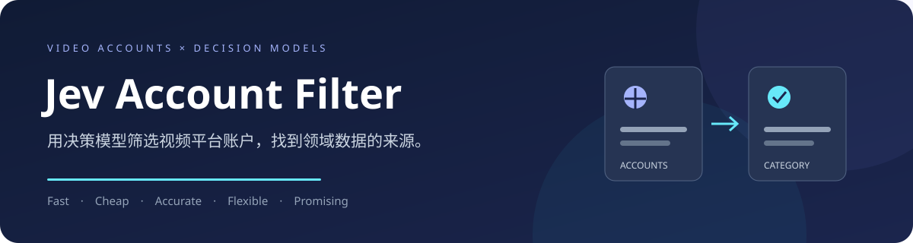
  
<strong>Find the accounts. Build the dataset.</strong>

  
用决策模型筛选视频平台账户，让领域数据集采集从更好的来源开始。

  
<kbd>Fast</kbd>　<kbd>Cheap</kbd>　<kbd>Accurate</kbd>　<kbd>Flexible</kbd>　<kbd>Promising</kbd>

  
<a href="docs/installation.zh-CN.md">安装</a> · <a href="docs/commands.zh-CN.md">运行指南</a> · <a href="docs/configuration.zh-CN.md">配置说明</a>

---

## 引言

从用户创作社区采集数据集，用于模型训练，正在成为越来越常见的研究路径。视频平台汇集了大量创作者持续发布的真实场景内容，为扩大训练数据规模、丰富内容分布和覆盖更多人群提供了机会。如何从这些持续增长的内容中找到特定领域的数据来源，也随之成为数据集构建的重要问题。

一条常见的采集路线是先确定相关账户，再通过视频模型和人工检查，筛出其中适合训练的具体视频。已有研究尝试了人工整理来源、自动检索候选和按频道抽查等方法，但筛选来源及审核内容仍需要投入人工。   候选账户越多，逐个浏览和判断的成本就越高；当类别边界或采集目标改变时，部分工作还需要重做。**账户筛选因此成为领域数据采集中的一道瓶颈。**

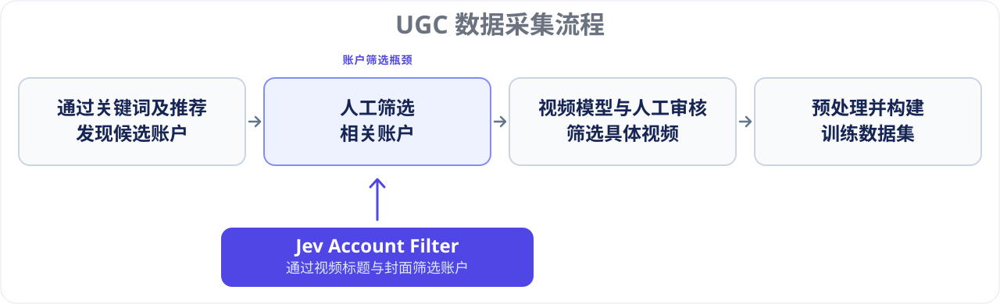

账户主页本身已经提供了丰富的预览信息：标题表达作品主题，封面呈现视觉线索，名称和简介补充创作者定位。这些信息为低成本的来源判断提供了可能。与此同时，决策模型能够把给定证据直接转换为类别选择和相关性概率，并在同一请求中回答多个独立问题，适合大规模、可重复的筛选任务。

**据我们所知，Jev Account Filter 是首个仅以视频标题和封面作为作品证据、为领域数据集采集筛选视频平台账户的项目，无需下载或逐个观看完整视频。** 项目先根据标题选择候选，再结合候选封面与账户资料独立判断账户类别，将大量备选账户转化为可采集、可复核的来源清单。采集资料与筛选规则分别保存，研究者可以在同一份采集数据上反复调整判据、替换模型并比较结果。这里的账户包括视频平台的创作者账号与频道；手语筛选是已经验证的一项应用，其他领域可通过类别配置接入。

### 贡献与优势

我们使用手语类别配置，在 **2140 个抖音账户**上验证了这套流程，直接使用现成的 **GPT-6 Luna Decisions**，未进行模型微调。

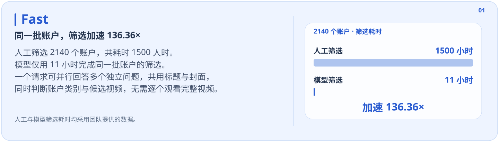

耗时比较口径

团队提供的人工筛选总工时为 **1500 人时**，模型筛选耗时为 **11 小时**，二者比值为 `1500 / 11 ≈ 136.36`。人工工时是投入的总劳动时间，人工并行作业时的日历耗时会不同。

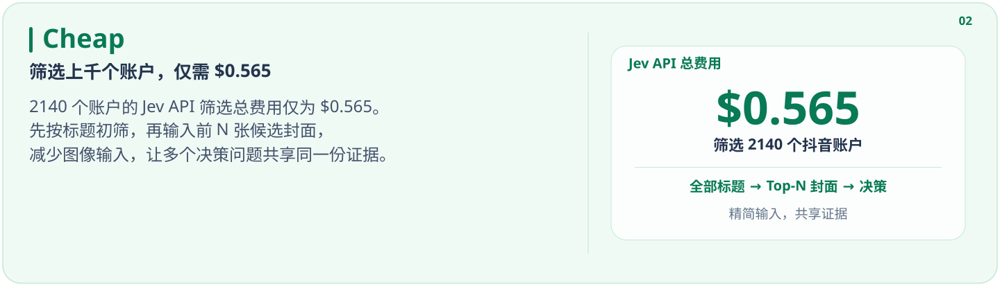

价格比较口径与来源

价格比较采用截至 **2026-10-16** 的官方标准单价，分别依据 [GPT-6 Luna 模型文档](https://developers.openai.com/api/docs/models/gpt-6-luna)和 [Decisions API 文档](https://developers.openai.com/api/docs/guides/decisions)；长上下文与区域处理另有加价。图中的 `gpt-6-luna-decisions` 指决策接口使用的模型，官方接口通过 `gpt-6-luna` 调用；输入与输出两组柱分别比较单位 token 价格，不代表整次实验的总费用。

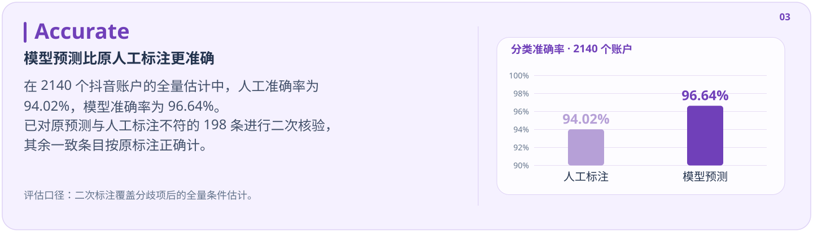

二次核验数据与准确率口径

对原预测与人工标注不一致的全部 **198 个账户**进行二次人工核验，以二次标签为参考；其余 **1942 个**预测与标注一致的条目假定原标注正确。按这一全量条件估计，原人工标注正确 **2012 / 2140**，错误 **128 个**，准确率为 **94.02%**；模型预测正确 **2068 / 2140**，错误 **72 个**，准确率为 **96.64%**。

这些数值比较双方相对于二次核验参考的准确率。由于一致条目未逐一独立复核，不能视为独立验证过的全量准确率。

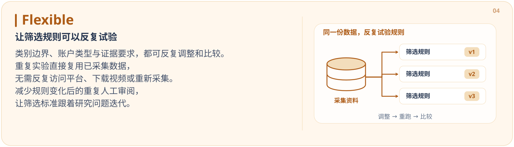

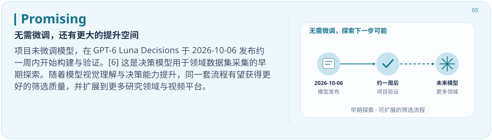

## 应用领域

从领域账户中选择稳定的数据来源，可以服务于多种 UGC 数据集采集任务。手语是本项目已验证的应用，其他领域是可拓展方向。下方仅列出论文明确描述了选定频道来源或频道级人工审核的数据集，展开可查看原文依据。

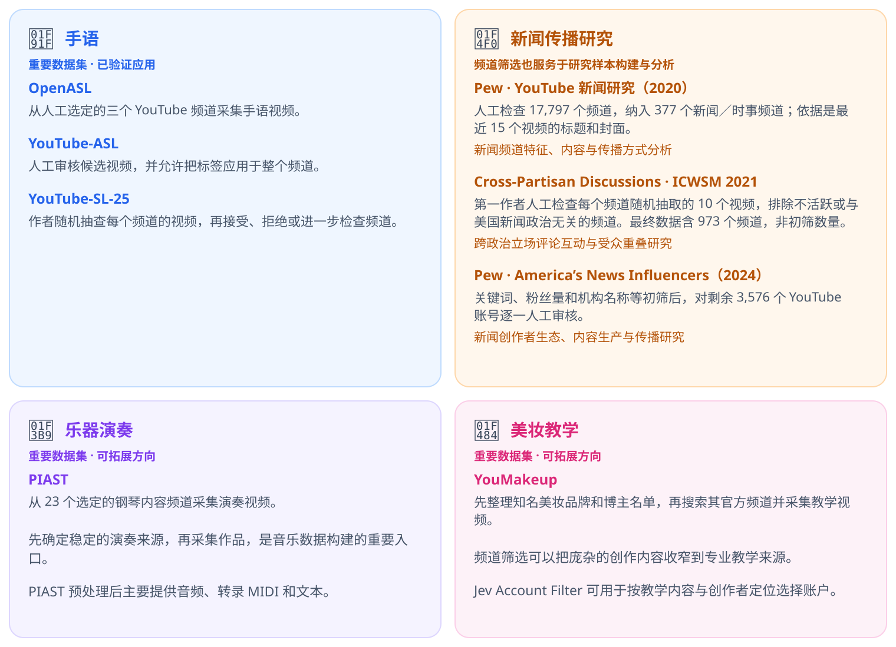

论文原文：频道来源与人工筛选依据

**[OpenASL](https://aclanthology.org/2022.emnlp-main.427.pdf#page=3) · §3。** 作者选定三个 YouTube 来源采集手语视频；原文写到 “in these two channels”，随后说明第三个来源。YouTube-ASL 的 [§2.1](https://papers.nips.cc/paper/2023/file/5c61452daca5f0c260e683b317d13a3f-Paper-Datasets_and_Benchmarks.pdf#page=2) 将 OpenASL 的来源选择归为 “manual channel curation”。

**[YouTube-ASL](https://papers.nips.cc/paper/2023/file/5c61452daca5f0c260e683b317d13a3f-Paper-Datasets_and_Benchmarks.pdf#page=4) · §3.2。** 候选通过自动标签检索，人工标注者可以把判断应用到整个频道；原文为 “labels held for an entire channel of videos”。这里的人工环节是频道级审核。

**[YouTube-SL-25](https://arxiv.org/html/2407.11144#S2.SS2) · §2.2。** 作者按频道抽查视频，再接受、拒绝或进一步检查该频道；原文为 “For each channel, the author sampled several random videos”。

**[PIAST](https://arxiv.org/html/2411.02551v2#S2.SS2) · §2.2。** 作者结合标签检索与选定频道采集，原文明确为 “23 selected channels known for their piano content”。论文描述的是研究者选定来源，未展开逐频道筛查细节；预处理后主要提供音频、转录 MIDI 和文本。

**[YouMakeup](https://aclanthology.org/anthology-files/pdf/D/D19/D19-1517.pdf#page=4) · §3.1。** 作者先整理知名美妆品牌和博主名单，再搜索其官方频道采集教学视频；原文为 “we search their official channels on the YouTube”。这体现了先选定账户来源、再采集作品的过程。

## 支持平台

采集适配器与类别规则相互独立。自定义来源只需遵守 [数据格式](docs/data-format.zh-CN.md)，无需实现平台适配器。

## 方法

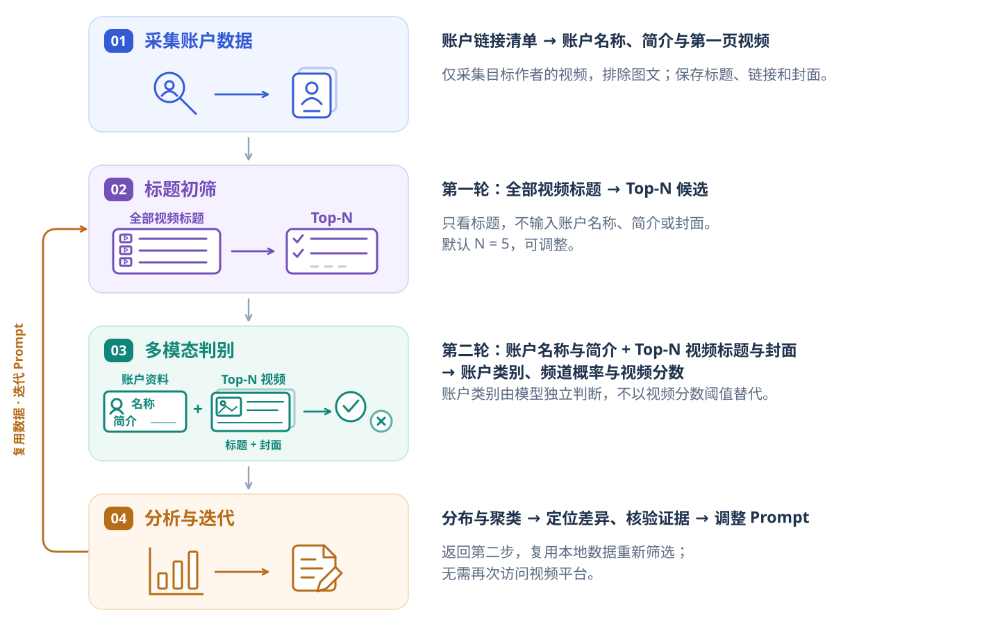

采集与筛选独立运行：`collect` 将 `input` 转换为正式 `data`，`screen` 从 `data` 生成 `results`，只访问所选模型 API。符合[数据格式](docs/data-format.zh-CN.md)的自定义来源可直接从第二个框开始。两轮模型调用依次完成候选选择和账户判别；调整 Prompt 后复用同一份采集数据，比较各轮结果，再将接受的账户交给后续视频采集与质量审核。

## 可视化分析

筛选结果不仅是一份账户清单。交互式分析页面将类别分布、分类表现、分数分布和特征聚类放在同一视图中，支持从汇总图表筛选到具体账户，再查看候选视频的标题、封面与模型分数。添加二次人工核验 CSV 后，页面会自动切换评估参考，并对比人工标注与模型预测的错误。

以下统计图表来自 **2140 个抖音账户**的完整实验；账户证据明细使用已授权公开的样例子集。不公开团队采集的完整账户清单与作品资料。

**数据集与分类表现。** 类别占比揭示样本构成；二次核验后的性能对照帮助区分模型错误与原标注错误。图中准确率采用条件估计：对 198 个原分歧项使用二次核验，其余 1942 个一致项假定原标注正确，未逐一独立复核。

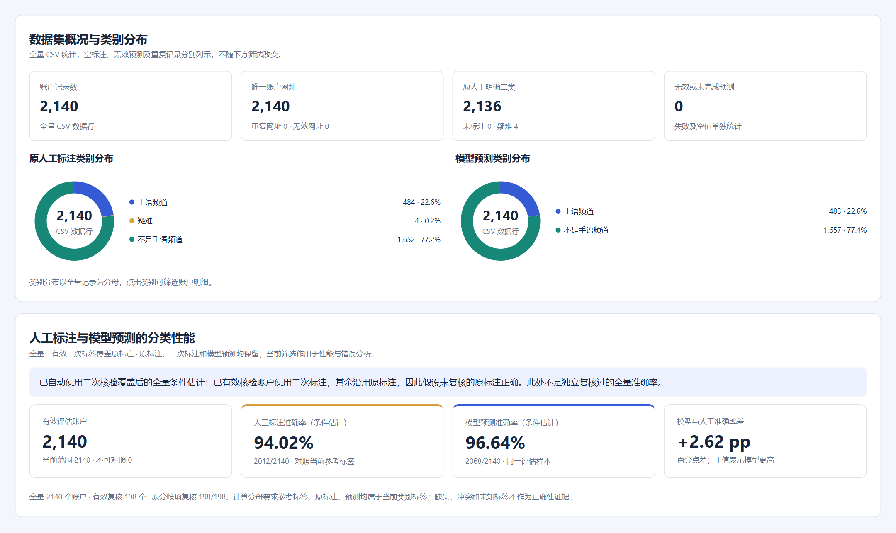

**误差与分数分布。** 混淆矩阵区分漏选与误选；归一化直方图对比人工错误样本和模型错误样本的频道概率分布，帮助定位需要重点复核的分数区间。两组错误可以重叠。

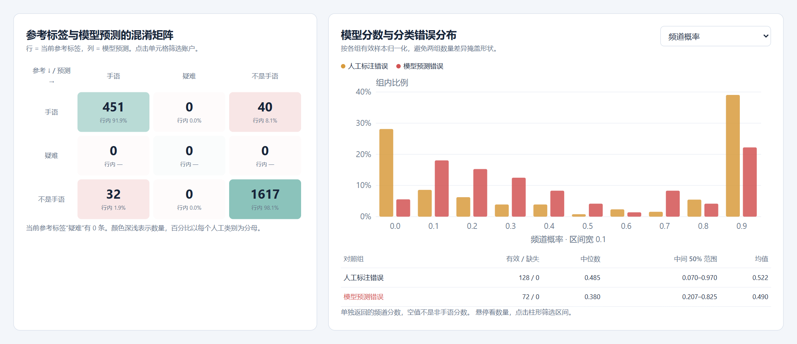

**输出模式聚类。** 将预测类别与五条候选视频的分数组合，观察不同证据强度的账户群体。散点图展示 PCA 投影，右侧展示各组的五条视频平均分与组内错误率；缺少完整五条分数的账户不补零、不参与聚类。聚类用于描述结果，不改变分类规则。

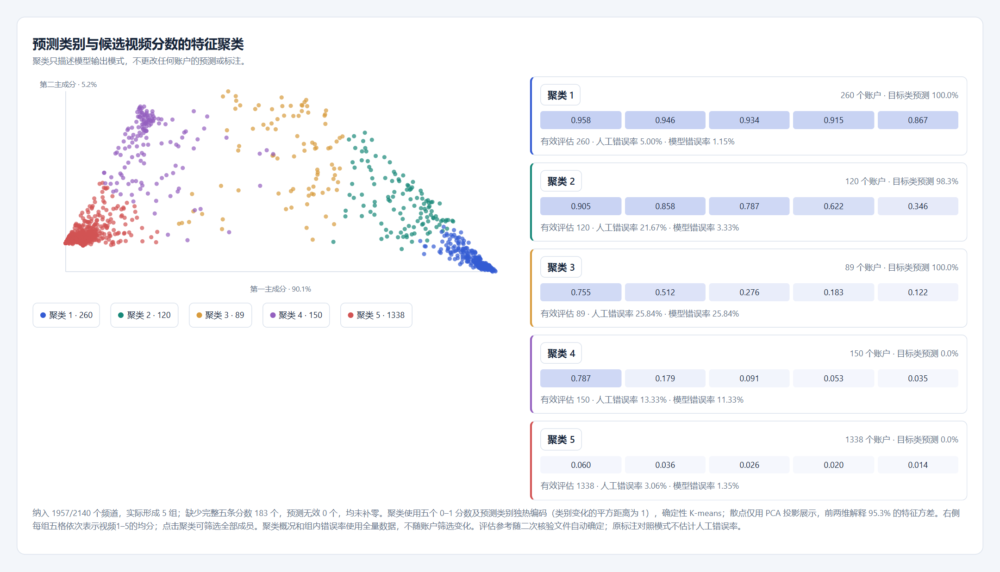

**人工标注与模型预测的错误特征对比。** 按参考类别、特征聚类或最高视频分数区间，比较双方的组内错误率。下图展示其中两种分组：模型并非在每个区间都优于人工；中间分数段的差异可以帮助安排后续复核。评估仍沿用上述条件估计口径。

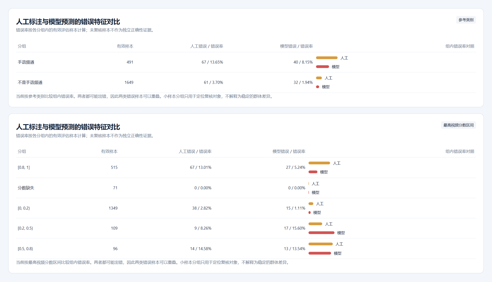

**账户评估结果与证据明细。** 原人工标注、二次核验、当前参考标签与模型预测并列展示，便于区分人工错误和模型错误。下图局部展示三个已授权公开的账户，以及其中一个账户的五条候选视频标题、封面与分数；完整交互页面支持筛选并展开其他条目。

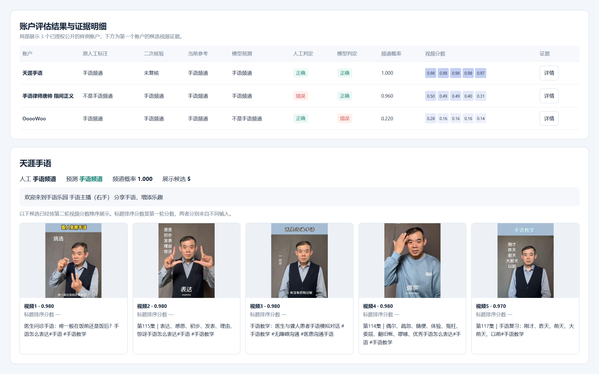

直接打开 [`analysis.html`](analysis.html) 会先展示 **6 个真实公开样例**；在页面中选择自己的结果 CSV 和可选的外部采集数据文件夹，复用同一页面分析不同实验，无需启动服务或重新生成报告。上方统计图来自全量实验，明细截图与默认交互样例使用公开子集。

## 开始使用

**[安装与环境](docs/installation.zh-CN.md)**：准备项目内的 Python 环境与浏览器。
**[配置说明](docs/configuration.zh-CN.md)**：选择服务商、模型与目标类别。
[运行命令](docs/commands.zh-CN.md) · [数据格式](docs/data-format.zh-CN.md)
